<div align="center">


# Quaestor

### _Give your agent a mandate, not a wallet._

**Delegable, on-chain-enforced USDC spending mandates for AI agents** — a human funds a tree of
agents, caps every branch, and can freeze any of it instantly. Enforced in the contract, accessed over **MCP**.
Same model on **Solana**, **EVM (Base · Tempo)**, and **Hyperliquid**.

<p>
  
  
  
  
  
  
  
</p>

**[Landing &amp; setup](https://quaestor-landing.vercel.app)** · **[Live dashboard](https://quaestor-dashboard.vercel.app)** · **[Solana program](https://explorer.solana.com/address/FVytqbLtyRAqshYkP8iacSGHbdT53tZNiLmoTG9Xu5dP?cluster=devnet)** · **[Base contract](https://sepolia.basescan.org/address/0xe704014D856aecD47B797CF47d42648060276d43)** · **[90-sec demo](#the-90-second-demo)**

<br/>



</div>

---

A human grants an agent a **Mandate** — an amount, a policy, and a lifetime, bound to
**one agent key**. The agent can carve **sub-mandates** for the agents it spawns, each
**tighter-or-equal** to its own. Every level is enforced **on-chain**, attributed per
spend, and revocable in one click. Agents reach their mandate through an **MCP server**
and hold **no gas** (a relayer pays the fees). Every limit lives in the contract — not in
a server that can be bypassed.

Same mandate model, enforced on **Solana** (Anchor), **EVM — Base / Tempo** (`Quaestor.sol`),
and **Hyperliquid** (`QuaestorDesk`, a trading-risk mandate), all driven by the same MCP tools.

---

### 🔗 Live

| | |
|---|---|
| **Landing & MCP setup** | https://quaestor-landing.vercel.app |
| **Dashboard (live mandate tree)** | https://quaestor-dashboard.vercel.app |
| **Solana program (devnet)** | [`FVytqbLtyRAqshYkP8iacSGHbdT53tZNiLmoTG9Xu5dP`](https://explorer.solana.com/address/FVytqbLtyRAqshYkP8iacSGHbdT53tZNiLmoTG9Xu5dP?cluster=devnet) |
| **Solana demo project (devnet)** | [`Bgo4nN4D5mVB7yjT5ymcGjhA83k23fbFPf5Ta44L3Kkr`](https://explorer.solana.com/address/Bgo4nN4D5mVB7yjT5ymcGjhA83k23fbFPf5Ta44L3Kkr?cluster=devnet) |
| **EVM contract (Base Sepolia)** | [`0xe704014D856aecD47B797CF47d42648060276d43`](https://sepolia.basescan.org/address/0xe704014D856aecD47B797CF47d42648060276d43) |
| **EVM gasless forwarder (Base Sepolia)** | [`0x10D587C78896a621328475d000a613a96eD64d6b`](https://sepolia.basescan.org/address/0x10D587C78896a621328475d000a613a96eD64d6b) |

_The Solana devnet RPC is served by **RPC Fast** (Superteam sidetrack)._

The same hierarchical mandates are enforced on **both** Solana (Anchor) and EVM (`Quaestor.sol`),
driven by the same MCP tools. Agents hold no gas on either chain.

Built solo for the **Colosseum Crypto World's Fair**.

---

## Three guarantees

Quaestor is three invariants — stated plainly, enforced in the contracts, and tested on
**both** Solana and EVM:

1. **Monotone delegation.** A sub-mandate is **tighter-or-equal to its parent on every
   dimension** — amount, allowlists, rate limit, expiry, and escalation threshold. No agent
   can widen its own authority; a delegation can only narrow it.
2. **No path out of the vault bypasses the policy check.** Every outflow goes through the
   same check-and-spend path (per-tx, period, allowlist, and the whole-ancestor-chain state).
   The **one** exception is owner withdrawal — and that is owner-signed.
3. **The principal can always revoke or freeze whole branches, immediately, without the
   agent's cooperation.** Freeze **cascades** down the subtree; revoke **returns unspent
   amounts up** the tree.

---

## Why Quaestor is different

Cloaked Agent, Squads spending limits, and native SPL delegates all cap a **single wallet**.
Quaestor delegates **authority down a chain of agents** — with monotone tightening, per-spend
attribution, and human escalation at every hop. Altitude (Squads) is the humans' stablecoin
account; **Quaestor is the agents' mandate layer on top of it.**

| | Flat agent wallets / spend limits | **Quaestor** |
|---|---|---|
| Scope | caps **one wallet** | delegates **authority down a chain of agents** |
| Delegation | — | agent carves sub-mandates, **monotonically tighter** |
| Enforcement | server / SDK | **in the contract**, on every spend |
| Attribution | — | **task_id + reason per spend**, hashed on-chain |
| Kill switch | revoke one key | **freeze a node → whole subtree stops** |
| Agent needs gas? | yes | **no — relayer pays fees** |
| Blast radius if agent compromised | whole wallet | **one mandate node** |

---

## The problem

Autonomous agents increasingly need to *pay* for things — data, compute, APIs, other agents.
The moment you give an agent the ability to spend, you face a control problem:

- Hand it a **private key** and it can drain the whole wallet. One prompt injection, one bug,
  and the money is gone.
- Existing agent wallets and spend limits (Coinbase Agentic Wallets, Squads limits, SPL
  delegation) cap a **single wallet**: *one human → one agent*. But real agent systems are
  **hierarchies** — an orchestrator spawns researchers, a researcher spawns scrapers. A flat
  allowance can't express "the research branch may spend at most 2 USDC, 0.50 per transaction,
  and I can freeze that entire branch in one click."

## The solution

Quaestor makes the **Mandate** the first-class object, not the key. The agent never holds a
private key to a funded wallet — it holds *authority* over a mandate **node**, and every spend
is checked against the whole ancestor chain, on-chain.

```
Owner (human)  ── funds the project vault with USDC
└── Orchestrator mandate            amount 6 USDC
    ├── Research sub-mandate          2 USDC · max 0.50 / tx · daily cap
    │   └── Scraper sub-sub-mandate   0.5 USDC
    └── Writer sub-mandate            1 USDC
```

- **Delegation is capped by construction.** A node can only grant what it *has available*, and
  a child's per-tx limit and expiry must be **tighter-or-equal** to its parent's.
- **Freeze once, stop the whole subtree.** Freezing the orchestrator instantly blocks every
  descendant's `spend` — enforced by an ancestor-chain walk inside the program.
- **Agents need no gas.** A relayer pays the transaction fee; the agent only signs to prove it
  owns the mandate node. Compromising an agent leaks a *mandate*, never a wallet.

---

## Spend attribution — a "Why?" per spend

Every spend carries a **task_id + reason**. The commitment is written **on-chain** — an **SPL
Memo** on Solana/Tempo, the **`Spent(…, taskId, reasonHash)`** event on EVM — while the plaintext
`reason` stays in an off-chain JSONL log keyed by tx signature. So a reviewer can verify
`sha256(reason) == reasonHash`, `get_history` and the dashboard can show the "Why?" behind every
payment, and spend rolls up into **cost per task**. Spending isn't just capped — it's **auditable
and attributable**.

---

## Per-chain showcase

One story per chain, no overlap — each plays to what that chain is actually best at.

| Chain | Showcase | Why this chain |
|---|---|---|
| **Solana** | A **research agent fleet** paying x402 APIs. One agent overspends → **rejected on-chain** → its **branch is frozen** → the dashboard shows **cost per report chapter**. | Fast, cheap, and the richest x402 / MCP tooling. |
| **Tempo** | A **stablecoin payout agent** paying contractors in tranches, with attribution carried in the chain's **native memo**. | A stablecoin-native payments chain. |
| **Base** | A mandate **bound to an agent identity** (ERC-8004 on the roadmap), running the **same policy schema** as Solana. | EVM reach and the Coinbase agent ecosystem. |
| **Hyperliquid** | A **trading desk**: pre-trade risk limits — allowed assets, max notional/order, max notional/day, and an **equity-floor drawdown stop** — enforced on **HyperEVM against live HyperCore state** *before* the CoreWriter order. | The one chain where **agent trading risk** is the obvious product. |

---

## How it works

### Reservation accounting (one invariant keeps it safe)

There is **one vault per project** (an ATA owned by the project PDA). Mandates are pure
accounting nodes — no token account per node. Each node (the `Budget` struct / PDA) tracks:

```
available = allocated − spent − reserved_for_children
```

with the single invariant **`spent + reserved_for_children ≤ allocated`** enforced on every
mutation via `checked_add`/`checked_sub` + a pre-check:

| Instruction | Pre-check |
|---|---|
| `allocate_child` / `increase_allocation` | `amount ≤ available(parent)` |
| `spend` | `amount ≤ available(node)` **and** per-tx / period limits **and** whole ancestor chain active |
| `reclaim` | `unused ≤ parent.reserved_for_children` (bottom-up only) |
| `withdraw` | `amount ≤ available(root)`, owner-only |

A randomized **property test** hammers the accounting core: after every random op it asserts
`spent + reserved ≤ allocated` per node and `Σ available ≤ vault balance`.

### Ancestor-chain enforcement

`spend` and `reclaim` receive the node's ancestors as `remaining_accounts`. The program walks
the chain, and for **each** ancestor: deserializes it as a `Budget` (checks program ownership +
discriminator), re-derives its PDA from `(project, agent)`, verifies `acc.key == child.parent`,
and enforces termination (`parent == None` exactly at the root, depth strictly decreasing). This
makes a forged, padded, foreign, or cyclic chain impossible — and lets a freeze/revoke high in
the tree stop every leaf below it.

### Security-critical design decisions

These were caught in a pre-implementation design review and are covered by tests:

- **Reclaim survives a revoked ancestor** — otherwise revoking a parent would lock a child's
  funds forever (no path to reclaim). `reclaim` is allowed when the child *or any ancestor* is
  revoked/expired.
- **`Option`-typed limits** — "unlimited" is `None`, never a `0` sentinel that could be confused
  with "zero allowed" in the child-≤-parent comparison.
- **Snap-to-now period reset** — `if now ≥ period_start + period_seconds { reset }` avoids the
  boundary-burst exploit of advancing by whole periods.
- **`init`, never `init_if_needed`** — no re-init / resurrection of a spent node.
- Classic `anchor_spl::token` (not Token-2022); `has_one` guards on owner/mint/vault/project;
  relayer is fee-payer only, never an authority.

---

## Business model

The mandate/policy layer is the **control plane for agent spend**: **SaaS** for the dashboard +
policy engine, plus a **take-rate on mandated agent spend** — sitting *atop* Altitude-style
stablecoin accounts rather than competing with them.

---

## The 90-second demo

`scripts/demo.sh` runs the whole story live on devnet (each step is a real transaction with an
explorer link). Paste the printed project address into the dashboard to watch the tree update live.
This is exactly the sequence animated at the top of this README.

1. Human creates a project and deposits **10 USDC**.
2. **Orchestrator** agent gets a **6 USDC** mandate.
3. Orchestrator carves a **2 USDC** sub-mandate for a **research** agent, capped at **0.50 / tx**
   *(the agent signs; the relayer pays the fee — the agent holds no SOL)*.
4. Research pays **2 × 0.50 USDC** for data. ✅
5. Research tries to spend **3 USDC** → **REJECTED on-chain** (exceeds per-tx limit). ⛔
6. Human **freezes the orchestrator** → research's next payment is **BLOCKED because an ancestor
   is frozen** — the whole subtree stops instantly. ⛔
7. Owner **revokes + reclaims** research's **unused 1 USDC** back up to the orchestrator
   (already-spent funds correctly stay spent). ♻️

```bash
QUAESTOR_RPC_URL="<devnet-rpc>" \
QUAESTOR_OWNER_KEYPAIR="$HOME/.config/solana/id.json" \
  bash scripts/demo.sh
```

---

## Repo layout

```
programs/quaestor/     Anchor program (Rust)            — the Solana enforcement core (10 instructions)
programs/quaestor/tests/                                — 28 LiteSVM tests (incl. property test)
contracts/             Quaestor.sol (Foundry)           — the EVM enforcement core (18 tests)
contracts/             QuaestorDesk.sol (Foundry)       — Hyperliquid trading-risk mandate (12 tests, incl. invariant)
packages/sdk/          @quaestor/sdk: PDAs, ix builders, mandate-tree fetch, unit conversion
packages/evm-sdk/      @quaestor/evm-sdk: viem client + EIP-2771 gasless forwarder
packages/mcp-server/   MCP server (stdio) + owner CLI — one ChainOps interface, Solana + EVM backends
apps/dashboard/        Next.js live mandate-tree UI (deployed to Vercel)
scripts/demo/          reproducible ~90s Solana demo · scripts/demo-evm.ts  gasless EVM demo
docs/                  mcp-setup.md, devnet.md, evm.md
```

### On-chain instructions

`create_project` · `deposit` · `allocate_child` · `increase_allocation` · `spend` ·
`set_status` (owner freeze/unfreeze) · `agent_set_status` (ancestor-agent freeze/unfreeze) ·
`revoke` · `reclaim` · `withdraw`

### MCP tools (what an agent sees)

`get_my_mandate` · `pay` · `create_submandate` · `list_subagents` ·
`freeze_subagent` · `revoke_subagent` · `reclaim_subagent` · `get_history` ·
`pay_x402` (pay for a paywalled HTTP resource straight from the mandate)

Amounts are in decimal USDC; errors are human-readable (`"Per-transaction limit exceeded:
limit 0.50 USDC"`). The agent's private key lives in an encrypted local keystore
(scrypt + AES-256-GCM) — the model **never** sees it.

### Owner CLI

`create-mint` · `fund` · `init` · `deposit` · `tree` · `allocate` · `freeze` · `revoke` ·
`withdraw` · `agent-create` · `agent-list`

---

## Getting started

Solana/Anchor development runs in **WSL2 Ubuntu**. Node tooling runs anywhere.

<details>
<summary><b>Build &amp; test — one block</b></summary>

```bash
pnpm install

# 1. Program: build + run the Rust/LiteSVM tests (in-process, no validator)
bash scripts/test.sh

# 2. SDK: build + test against a local validator
bash scripts/test-sdk.sh

# 3. MCP server end-to-end test
bash scripts/test-mcp.sh

# 4. Dashboard (local)
pnpm --filter @quaestor/sdk build && pnpm --filter @quaestor/dashboard dev
```

Connecting the MCP server to Claude Desktop/Code: see [`docs/mcp-setup.md`](docs/mcp-setup.md).
Devnet deployment notes: see [`docs/devnet.md`](docs/devnet.md).

</details>

<details>
<summary><b>Toolchain (pinned)</b></summary>

<br/>

| Tool | Version |
|---|---|
| Anchor (Rust `anchor-lang` / CLI) | 1.2.0 |
| `@coral-xyz/anchor` (JS) | 0.32.1 |
| Solana CLI (Agave) | 4.x (stable) |
| `@solana/web3.js` / `@solana/spl-token` | 1.99 / 0.4 |
| MCP TS SDK | 1.30.1 |
| Node / pnpm | 22 / 10.17 |

</details>

---

## What's live

Not a mock — every piece below runs on devnet / a local validator / anvil. No mainnet keys; no
private keys in git.

- **Solana program on devnet** — 10 instructions, ancestor-chain enforcement, reservation
  accounting; **28 Rust/LiteSVM tests** incl. a randomized property test on the accounting invariant.
- **EVM port** (`contracts/Quaestor.sol`) — a faithful Solidity port, **18 Foundry tests incl. an
  invariant fuzz**, plus **on-chain attribution** (`Spent(…, taskId, reasonHash)`) and an
  **EIP-2771 gasless forwarder** so agents hold no gas on EVM either.
- **QuaestorDesk** (`contracts/src/QuaestorDesk.sol`) — the **Hyperliquid trading-risk mandate**:
  allowed assets, max notional/order, max notional/day, and an equity-floor drawdown stop, checked
  on HyperEVM against live HyperCore state before the CoreWriter order. **12 Foundry tests incl. an
  invariant.**
- **Spend attribution** — task_id + reason, SPL Memo on Solana/Tempo and the `Spent` event on EVM,
  plaintext in an off-chain log, surfaced in `get_history` and the dashboard.
- **9-tool MCP server** an agent drives from Claude Desktop/Code (`get_my_mandate`, `pay`,
  `create_submandate`, `list_subagents`, `freeze_subagent`, `revoke_subagent`, `reclaim_subagent`,
  `get_history`, `pay_x402`) behind a **`QUAESTOR_CHAIN`** switch — the same tools drive Solana or
  EVM via one `ChainOps` interface. Encrypted local keystore (scrypt + AES-256-GCM) so the model
  never sees a key.
- **Owner CLI** + a **live dashboard**: https://quaestor-dashboard.vercel.app
- **Reproducible demos** on devnet (Solana) and anvil (EVM gasless + x402) with real explorer links.

<details>
<summary><b>Milestones</b></summary>

<br/>

- [x] **M1** Anchor program + LiteSVM tests (the enforcement core)
- [x] **M2** TS SDK (PDAs, ix builders, mandate-tree fetch)
- [x] **M3** MCP server (9 tools) + owner CLI (11 commands)
- [x] **M4** Dashboard — live tree, deployed to Vercel
- [x] **M5** Reproducible ~90s demo scenario
- [x] **M6** Devnet deploy · docs · submission
- [x] **M7** Ancestor-**agent** freeze — a parent/grandparent agent can freeze a descendant subtree (28 Rust/LiteSVM tests)
- [x] **M8** EVM port — `contracts/Quaestor.sol`, a faithful Solidity port + 18 Foundry tests incl. an invariant fuzz
- [x] **M9** `@quaestor/evm-sdk` — viem client + **EIP-2771 gasless forwarder**
- [x] **M10** `QUAESTOR_CHAIN` switch — the same MCP tools drive Solana or EVM behind one `ChainOps` interface
- [x] **M11** On-chain spend attribution — task_id + reason (SPL Memo / `Spent` event) + off-chain log
- [x] **M12** **QuaestorDesk** — Hyperliquid trading-risk mandate (`QuaestorDesk.sol` + 12 Foundry tests incl. invariant)

</details>

### Multi-chain

The mandate model is chain-agnostic, so Quaestor runs on **Solana**, **EVM**, and **Hyperliquid**
from one codebase:

| | Solana | EVM (Tempo · Base) | Hyperliquid |
|---|---|---|---|
| Enforcement | Anchor program, PDAs | `Quaestor.sol`, storage mappings | `QuaestorDesk.sol`, pre-trade risk checks |
| Gasless | relayer fee-payer | ERC-2771 forwarder (`_msgSender`) | ERC-2771 forwarder |
| Client | `@quaestor/sdk` (Anchor) | `@quaestor/evm-sdk` (viem) | `@quaestor/evm-sdk` (viem) |
| Agent access | MCP (`QUAESTOR_CHAIN=solana`) | MCP (`QUAESTOR_CHAIN=tempo\|base`) | HyperEVM + CoreWriter |

The `spent + reserved ≤ allocated` invariant, the ancestor-chain walk, `Option`-typed limits,
snap-to-now period reset, and ancestor-agent freeze are identical across chains. See
[`docs/evm.md`](docs/evm.md) to deploy + wire the MCP server to an EVM chain.

### x402 (shipped)

An agent can pay for a **paywalled HTTP resource** directly from its on-chain-enforced mandate
(`pay_x402`): on an HTTP `402`, Quaestor pays the required USDC from the mandate — so the per-tx,
daily, allowlist, and freeze limits apply to real-world API payments — attaches the on-chain payment
as proof, and retries. A 3 USDC request against a 0.50/tx mandate is **rejected before the resource
is ever fetched**. Demo: `scripts/x402-demo.sh` (self-contained on anvil).

---

## Roadmap

**Near-term (Tier 1).** Plain-language mandates (the Claude API fills a policy schema from a sentence),
escalation/approvals (Blink + Telegram), a dead-man switch, session keys, a cost-per-task dashboard +
burn-rate forecast, x402 receipts, Reflect yield on the idle vault, Phantom Connect, and policy replay.

**Later (Tier 2).** Identity binding (Metaplex Agent Registry / ERC-8004 "Know Your Agent"),
reputation-weighted mandate sizing, cross-org sub-mandates with escrow, governance-originated
mandates (Realms), and confidential mandates.

## License

MIT
